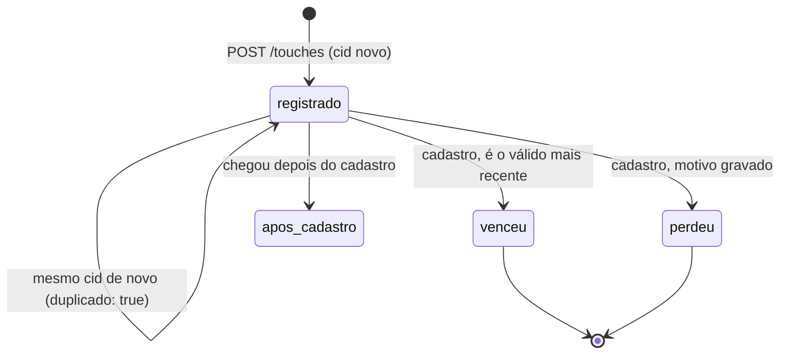

# Origem do cadastro no app

Esta API diz por qual link um criador chegou ao cadastro: campanha, indicação, comunidade ou nenhum (orgânico). O webview do Instagram e do WhatsApp costuma não mandar referrer, então a atribuição usa só o que viaja na URL. O app repassa essa URL para a API.

Stack: Node 22+, TypeScript, Hono, `node:sqlite`, Vitest e k6 (via Docker) para carga.

## Como rodar

```bash
npm install
npm run dev          # http://localhost:3000, banco em ./origem.db
npm test             # unitários + integração + concorrência
npm run typecheck
npm run load         # precisa de Docker; sobe a API na porta 3104 com banco temporário
```

Variáveis de ambiente:

| variável | padrão | para que serve |
|---|---|---|
| `PORT` | `3000` | porta HTTP |
| `DB_PATH` | `origem.db` | arquivo sqlite |
| `ATTRIBUTION_WINDOW_HOURS` | `168` (7 dias) | janela de validade, contada a partir da primeira abertura do app |
| `APP_LINK_BASE` | `https://conty.app/abrir` | endereço que abre o app (universal link / app link) |

## O contrato

São três momentos: o clique, a abertura do app e o cadastro.

### 1. O que viaja no link

O link público não tem identificador de clique. Ele passa por um redirecionador (`GET /l`), que valida os parâmetros, gera um `cid` novo para aquele clique e manda o navegador para o link que abre o app:

| fonte | `src` | obrigatório | opcional |
|---|---|---|---|
| campanha | `campanha` | `cmp` (id da campanha) | `ch` (canal: instagram, tiktok...) |
| indicação | `indicacao` | `ref` (código de quem indicou) | |
| comunidade | `comunidade` | `com` (id da comunidade) | `ch` |

Valores aceitam letras, números, `_`, `.` e `-` (até 64 caracteres). Parâmetros desconhecidos são descartados. O `cid` tem de 8 a 64 caracteres.

Exemplo de link de campanha (o que vai no post ou no anúncio):

```
https://conty.app/l?src=campanha&cmp=cmp_123&ch=instagram
```

Exemplo de link de indicação (o que o criador compartilha):

```
https://conty.app/l?src=indicacao&ref=MARIA2026
```

O que o redirecionador devolve (chamadas reais):

```
$ curl -si "localhost:3104/l?src=campanha&cmp=cmp_123&ch=instagram"
HTTP/1.1 302 Found
location: https://conty.app/abrir?src=campanha&cmp=cmp_123&ch=instagram&cid=clk_787304c81ffe4d9a901ef342cf9c37b0

$ curl -si "localhost:3104/l?src=indicacao&ref=MARIA2026"
HTTP/1.1 302 Found
location: https://conty.app/abrir?src=indicacao&ref=MARIA2026&cid=clk_811b190d164948669e0e7af68b168bef

$ curl -s "localhost:3104/l?src=indicacao"
{"error":{"code":"link_invalido","message":"link de indicacao precisa do parâmetro ref"}}
```

O `cid` nasce no clique, então reabrir o mesmo link pelo histórico, ou o app receber o mesmo deep link duas vezes, chega com o mesmo `cid`. É ele a chave de dedupe.

### 2. O que o app grava

Na primeira abertura, o app gera um `install_id` (um UUID guardado no aparelho) e chama `POST /installs`. O servidor grava `first_open_at` com o relógio dele. Chamar de novo não muda nada.

Toda vez que o app é aberto por um link, ele manda `POST /touches` com o `install_id` e a URL que recebeu, sem interpretar nada. Pode mandar também `opened_at` (relógio do aparelho), que fica guardado só para auditoria. O horário que vale para a regra é o do servidor no momento em que o toque chega, porque relógio de celular não é confiável.

Se o toque chegar antes do `POST /installs` (o app foi instalado pelo próprio link e as duas chamadas saíram juntas), o toque registra a primeira abertura com o horário dele.

### 3. O que o cadastro consome

`POST /signups {user_id, install_id}` lê todos os toques do install, aplica a regra e grava, numa transação, a origem final e um veredito (`venceu`/`perdeu` + motivo) para cada toque considerado. Essa resposta é a auditoria, e `GET /signups/:user_id/attribution` devolve a mesma coisa depois.

## Regras e onde elas vivem

A regra inteira é a função pura `decideAttribution` em [`src/attribution.ts`](src/attribution.ts). Ela recebe os toques, `first_open_at`, o horário do cadastro e a janela, e devolve origem, motivo e veredito por toque. Os testes de [`test/unit/attribution.test.ts`](test/unit/attribution.test.ts) cobrem cada caso sem banco.

1. Janela: um toque só é válido se `first_open_at <= touched_at <= first_open_at + janela`. A janela padrão é 7 dias (`ATTRIBUTION_WINDOW_HOURS`), e o limite é inclusivo. Cada cadastro grava a janela que usou (`window_ms`), então mudar a configuração não reescreve o passado, e a resposta mostra `janela_inicio` e `janela_fim`.
2. Toque com horário posterior ao cadastro perde com `posterior_ao_cadastro`. Toque no mesmo milissegundo do cadastro ainda conta.
3. Vence o toque válido mais recente (last touch).
4. Em empate de horário, a ordem é `campanha > indicacao > comunidade`. Se a fonte também empata, vence o menor `click_id` em ordem lexical. Assim o resultado nunca depende da ordem em que os toques foram lidos.
5. `touches.click_id` é UNIQUE: o mesmo clique reenviado devolve o toque existente com `duplicado: true`. E `signups.winning_touch_id` também é UNIQUE: se duas pessoas se cadastram no mesmo aparelho, o segundo cadastro não reaproveita o clique que já virou origem do primeiro (motivo `ja_usado_em_outro_cadastro`).
6. Sem toque válido, a origem é `organico` e o motivo fica gravado: `sem_toques` (o install não tem nenhum), `nenhum_toque_valido` (tinha, mas todos perderam por janela, por serem posteriores ou já usados) ou `install_desconhecido` (o cadastro veio de um `install_id` que nunca abriu o app pela API).
7. O cadastro é idempotente: o mesmo `user_id` com o mesmo `install_id` devolve a decisão gravada (200), mesmo que tenham chegado toques novos. Com outro `install_id`, 409.

Motivos possíveis por toque:

| motivo | resultado |
|---|---|
| `toque_mais_recente_na_janela` | venceu |
| `venceu_empate_por_prioridade` / `venceu_empate_por_click_id` | venceu |
| `perdeu_para_toque_mais_recente` | perdeu |
| `empate_desfeito_por_prioridade` / `empate_desfeito_por_click_id` | perdeu |
| `fora_da_janela` | perdeu |
| `posterior_ao_cadastro` | perdeu |
| `ja_usado_em_outro_cadastro` | perdeu |
| `anterior_a_primeira_abertura` | perdeu (defensivo; com horário do servidor não acontece) |

### Por que last touch e por que essa ordem de desempate

Escolhi last touch porque o link mais recente antes do cadastro é o que estava na frente da pessoa quando ela decidiu se cadastrar. First touch também seria defensável (premia quem apresentou a Conty primeiro). Como a regra está isolada numa função, trocar é mexer em `compareTouches` e nos testes.

Empate exato de milissegundo é raro com horário do servidor. Mesmo assim ele precisa ter resposta, senão o resultado dependeria da ordem de leitura do banco. A ordem `campanha > indicacao > comunidade` vai do link mais específico e mais caro de produzir para o mais difuso. É uma decisão de produto, está numa constante (`TIE_PRIORITY`) e aparece na resposta (`regra.desempate`). O último critério, `click_id`, existe só para o resultado ser determinístico.

## Modelo de dados

```
installs        (install_id PK, first_open_at)
touches         (id PK, click_id UNIQUE, install_id, source, params JSON, touched_at, client_opened_at)
signups         (user_id PK, install_id, signup_at, first_open_at, window_ms,
                 origin, reason, winning_touch_id UNIQUE NULL)
signup_touches  (user_id, touch_id, result, reason)  PK (user_id, touch_id)
```

`signup_touches` é o retrato do que foi considerado no momento do cadastro. Toques que chegam depois ficam em `touches`, e o `GET` os lista à parte em `toques_apos_cadastro`, com motivo `posterior_ao_cadastro`, sem mexer na origem.

Ciclo de vida de um toque:



## Exemplos reais

Saídas copiadas de uma sessão com a API rodando na porta 3104 e `curl`. Formatei o JSON grande para leitura.

Primeira abertura:

```
$ curl -s localhost:3104/installs -H 'content-type: application/json' -d '{"install_id":"inst_8f2c"}'
{"install_id":"inst_8f2c","first_open_at":"2026-10-10T03:24:56.901Z","novo":true}     # 201
```

O app abre pelo link de campanha, e o mesmo link é reenviado:

```
$ curl -s localhost:3104/touches -H 'content-type: application/json' \
  -d '{"install_id":"inst_8f2c","url":"https://conty.app/abrir?src=campanha&cmp=cmp_123&ch=instagram&cid=clk_23bf58b928034451b34197a9fb42e2a0","opened_at":"2026-10-10T03:30:00.000Z"}'
{"install_id":"inst_8f2c","click_id":"clk_23bf58b928034451b34197a9fb42e2a0","source":"campanha","params":{"cmp":"cmp_123","ch":"instagram"},"touched_at":"2026-10-10T03:24:56.911Z","client_opened_at":"2026-10-10T03:30:00.000Z","duplicado":false}   # 201

# mesma URL de novo
{"install_id":"inst_8f2c","click_id":"clk_23bf58b928034451b34197a9fb42e2a0","source":"campanha","params":{"cmp":"cmp_123","ch":"instagram"},"touched_at":"2026-10-10T03:24:56.911Z","client_opened_at":"2026-10-10T03:30:00.000Z","duplicado":true}    # 200
```

Um segundo depois, chega um link de indicação. Aí vem o cadastro:

```
$ curl -s localhost:3104/signups -H 'content-type: application/json' -d '{"user_id":"u_ana","install_id":"inst_8f2c"}'
```

Depois do cadastro chega um link de comunidade (`clk_manual_0001`). A auditoria fica assim:

```
$ curl -s localhost:3104/signups/u_ana/attribution
```

```json
{
  "user_id": "u_ana",
  "install_id": "inst_8f2c",
  "signup_at": "2026-10-10T03:24:57.945Z",
  "origem": {
    "tipo": "indicacao",
    "motivo": "toque_mais_recente_na_janela",
    "click_id": "clk_074a95dcc56a4fd7b4945470a72337f4",
    "params": { "ref": "MARIA2026" }
  },
  "regra": {
    "nome": "last_touch",
    "janela_horas": 168,
    "janela_inicio": "2026-10-10T03:24:56.901Z",
    "janela_fim": "2026-10-17T03:24:56.901Z",
    "desempate": ["campanha", "indicacao", "comunidade", "click_id"]
  },
  "toques_considerados": [
    {
      "click_id": "clk_23bf58b928034451b34197a9fb42e2a0",
      "source": "campanha",
      "params": { "cmp": "cmp_123", "ch": "instagram" },
      "touched_at": "2026-10-10T03:24:56.911Z",
      "client_opened_at": "2026-10-10T03:30:00.000Z",
      "resultado": "perdeu",
      "motivo": "perdeu_para_toque_mais_recente"
    },
    {
      "click_id": "clk_074a95dcc56a4fd7b4945470a72337f4",
      "source": "indicacao",
      "params": { "ref": "MARIA2026" },
      "touched_at": "2026-10-10T03:24:57.936Z",
      "client_opened_at": null,
      "resultado": "venceu",
      "motivo": "toque_mais_recente_na_janela"
    }
  ],
  "toques_apos_cadastro": [
    {
      "click_id": "clk_manual_0001",
      "source": "comunidade",
      "params": { "com": "grupo_ugc" },
      "touched_at": "2026-10-10T03:24:57.963Z",
      "client_opened_at": null,
      "resultado": "perdeu",
      "motivo": "posterior_ao_cadastro"
    }
  ]
}
```

O `POST /signups` devolveu o mesmo corpo com status 201, só que ainda com `toques_apos_cadastro` vazio. Repetir o `POST` devolveu 200.

Cadastro sem link nenhum:

```json
{
  "user_id": "u_bia",
  "install_id": "inst_77aa",
  "signup_at": "2026-10-10T03:24:57.994Z",
  "origem": { "tipo": "organico", "motivo": "sem_toques", "click_id": null, "params": null },
  "regra": {
    "nome": "last_touch",
    "janela_horas": 168,
    "janela_inicio": "2026-10-10T03:24:57.982Z",
    "janela_fim": "2026-10-17T03:24:57.982Z",
    "desempate": ["campanha", "indicacao", "comunidade", "click_id"]
  },
  "toques_considerados": [],
  "toques_apos_cadastro": []
}
```

Erros seguem `{ "error": { "code", "message" } }`: 400 para validação e link inválido, 404 para cadastro inexistente, 409 para `click_de_outro_install` (o mesmo `cid` reportado por outro aparelho) e `cadastro_com_outro_install`.

## Onde cada requisito tem teste

| requisito | teste |
|---|---|
| dois links diferentes antes do cadastro | `api.test.ts`: "dois links diferentes antes do cadastro: vence o mais recente e o outro aparece como perdedor"; `attribution.test.ts`: "dois links diferentes antes do cadastro" |
| empate de horário | `api.test.ts`: "empate de horário: campanha vence indicação e comunidade..."; `attribution.test.ts`: dois testes de empate (prioridade e click_id) |
| clique repetido não cria duas origens | `api.test.ts`: "o mesmo clique reenviado não cria segundo toque nem segunda origem"; `concurrency.test.ts`: "50 envios concorrentes do mesmo clique geram um toque só" |
| toque fora da janela não vence | `api.test.ts`: "toque fora da janela (medida do first_open_at) não vence"; `attribution.test.ts`: "janela é medida do first_open_at e o limite é inclusivo" |
| toque posterior ao cadastro não vence | `api.test.ts`: "toque posterior ao cadastro é registrado, aparece na auditoria e não altera a origem" |
| orgânico com motivo | `api.test.ts`: "cadastro sem toque fica orgânico com motivo sem_toques gravado", "só toque fora da janela...", "install nunca visto..." |
| auditoria | `GET /signups/:id/attribution` em vários testes de `api.test.ts` |
| cadastro idempotente e concorrente | `api.test.ts`: "cadastro repetido devolve a mesma decisão..."; `concurrency.test.ts`: "cadastros duplicados concorrentes gravam uma origem só..." |
| exemplos de link | `api.test.ts`: "link de campanha redireciona..." e "link de indicação redireciona..."; `link.test.ts` |

Os testes de integração usam `app.request` com sqlite `:memory:` e um `FixedClock` ([`src/clock.ts`](src/clock.ts)) que só anda quando o teste manda. Com ele, o empate de horário e a janela de 7 dias são testados sem espera.

## Idempotência e concorrência

- `touches.click_id UNIQUE` + `INSERT ... ON CONFLICT DO NOTHING`: um registro por clique, qualquer que seja o número de reenvios.
- `installs.install_id PK` + `ON CONFLICT DO NOTHING`: `first_open_at` é gravado uma vez só.
- `POST /signups` roda em `BEGIN IMMEDIATE`: lê o cadastro existente, lê os toques, decide e grava, tudo na mesma transação. `signups.user_id PK` e `signups.winning_touch_id UNIQUE` são a rede de segurança se algum dia duas escritas passarem.
- Cadastros concorrentes de pessoas diferentes no mesmo aparelho são serializados. Quem entra primeiro leva o toque mais recente e o segundo leva o próximo válido. A ordem entre esses dois depende de quem chegou primeiro, e isso está registrado na auditoria de cada um.

## Por que essa solução

O volume aqui é de cadastros e aberturas de app de uma plataforma de criadores. Estou supondo que, mesmo num pico de campanha, isso fique na casa de dezenas a centenas de escritas por segundo. Um processo Node com sqlite já serializa as escritas, e as restrições UNIQUE resolvem a idempotência sem precisar de lock. Não usei Redis porque não há efeito colateral externo para proteger. São só linhas no banco, e o banco já garante a unicidade.

Com várias instâncias da API, eu trocaria sqlite por Postgres mantendo as mesmas restrições (`UNIQUE(click_id)`, `UNIQUE(winning_touch_id)`, PK em `user_id`) e faria o cadastro com `SELECT ... FOR UPDATE` nas linhas do install, ou com `INSERT ... ON CONFLICT` no cadastro antes de decidir. Lock distribuído só entraria se o cadastro passasse a disparar algo fora do banco (pagar bônus de indicação, por exemplo), e mesmo aí eu tentaria primeiro uma tabela de saída (outbox) com chave de idempotência.

## Teste de carga

`npm run load` sobe a API na porta 3104 com banco temporário e roda [`load/attribution.js`](load/attribution.js) no `grafana/k6:0.54.0`. Cada iteração é um aparelho, e são 2000 aparelhos divididos entre 20 VUs. Os 5 reenvios de cada clique e os 3 reenvios de cada cadastro saem em paralelo (`http.batch`). Os aparelhos se dividem em quatro perfis:

- sem link (primeira abertura repetida e cadastro): esperado `organico`;
- um link de campanha: esperado `campanha` com aquele `cid`;
- indicação e depois campanha: esperado `campanha` com o segundo `cid`;
- indicação, cadastro e depois um link de comunidade: esperado `indicacao`, com o de comunidade fora da decisão.

Os checks do k6 conferem que cada lote de reenvios teve exatamente um 201 e o resto 200, e que todas as respostas de cadastro trouxeram a origem esperada. No fim, [`scripts/verify-load.ts`](scripts/verify-load.ts) lê o banco e sai com código 1 se: houver mais toques que cliques distintos; algum cadastro faltar ou sobrar; um toque for origem de dois cadastros; alguma origem diferir da esperada; a auditoria gravada não bater com `decideAttribution` recalculada sobre o mesmo retrato; ou o toque posterior ao cadastro tiver entrado na decisão.

Resultado de uma execução real na minha máquina (macOS, Docker Desktop):

```
checks.........................: 100.00% 6500 out of 6500
http_req_duration..............: avg=20.64ms med=14.2ms p(90)=37.45ms p(95)=56.35ms max=737.58ms
http_req_failed................: 0.00%   0 out of 20000
http_reqs......................: 20000   3183.188881/s
iterations.....................: 2000    318.318888/s

toques: 2500 (esperado 2500), cliques distintos: 2500
cadastros: 2000 (esperado 2000), origens conferidas e auditorias recalculadas: 2000
OK: um toque por click_id, uma origem por cadastro, todas iguais à esperada.
```

Thresholds: `p(95) < 200ms`, `http_req_failed < 1%`, `checks > 99%`. Numa segunda execução, antes de publicar, o p95 ficou em 74,29 ms e a vazão em 3410 req/s, com os mesmos 100% de checks e a verificação OK.

Comecei com 50 VUs (até 250 conexões abertas de uma vez) e vi entre 0,7% e 2% de requisições falhando com `EOF`/`connection refused`. Reproduzi o mesmo com `fetch` direto do host, sem Docker no meio, e o limite de backlog do macOS (`kern.ipc.somaxconn = 128`) é o suspeito mais provável. Não confirmei a causa a fundo. Com 20 VUs (até 100 conexões) não houve falha. Nas rodadas que falharam, os checks reprovados eram de lotes com requisição sem resposta. A verificação do banco não rodou nelas, porque o script para quando o k6 reprova um threshold.

## O que ficou de fora

- Deferred deep link: quando a pessoa clica, vai para a loja e instala, o deep link se perde no caminho. Recuperar o `cid` nesse caso depende de mecanismo da plataforma (Install Referrer no Android, área de transferência ou um serviço tipo Branch no iOS). O contrato aceita esse `cid` do mesmo jeito; só não implementei a captura.
- Autenticação das chamadas do app e assinatura do link (hoje dá para forjar um `src=campanha`). Um HMAC em cima de `src`+params+`cid` no redirecionador resolveria.
- Relatório agregado por campanha ou por código de indicação. Os dados estão nas tabelas, mas não há endpoint.
- O redirecionador não grava o clique. Gravar daria a taxa de clique para abertura, mas não muda a atribuição.

## O que eu faria diferente com mais tempo

- Guardaria a versão da regra no cadastro (`regra.versao`), para poder mudar de last touch para outra coisa sem ambiguidade na leitura de cadastros antigos.
- Mediria a carga em Linux, para separar o que é limite do macOS do que é limite da API.
- Testaria com propriedades (fast-check) que `decideAttribution` é independente da ordem de entrada e que sempre há no máximo um vencedor.

## Uso de IA

O código, os testes e este README foram produzidos com Claude Code (Claude Opus) a partir do enunciado do desafio. As decisões de modelagem (last touch, ordem de desempate, horário do servidor como referência, `cid` gerado no redirecionador) foram propostas durante essa sessão e estão justificadas acima.

O que eu revisei: _(rascunho para eu confirmar)_ revisei a regra de atribuição e os motivos de cada toque, li os testes de integração conferindo que cada requisito do enunciado tem um teste com nome encontrável, rodei `npm test`, `npm run typecheck` e `npm run load` localmente e conferi os exemplos de `curl` deste README contra a API rodando.
