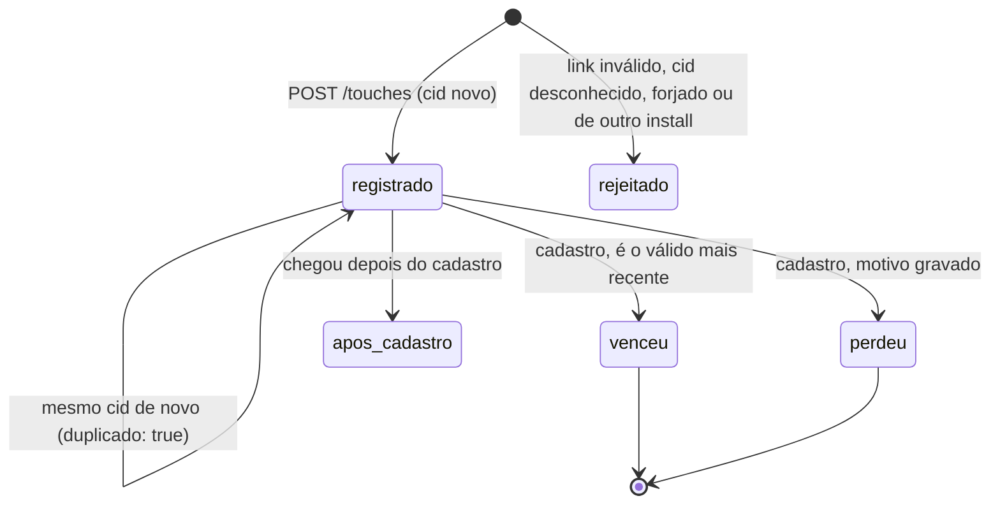

# Origem do cadastro no app

Esta API diz por qual link um criador chegou ao cadastro: campanha, indicação, comunidade ou nenhum (orgânico). O webview do Instagram e do WhatsApp costuma não mandar referrer, então a atribuição usa só o que viaja na URL. O app repassa essa URL para a API.

Stack: Node 22.13+, TypeScript, Hono, zod, `node:sqlite`, Vitest e k6 (via Docker) para carga.

## Como rodar

```bash
npm install
npm run dev          # http://localhost:3000, banco em ./origem.db
npm test             # unitários, integração, payloads inválidos e concorrência
npm run typecheck
npm run load         # precisa de Docker; sobe a API na porta 3104 com banco temporário
```

| variável | padrão | para que serve |
|---|---|---|
| `PORT` | `3000` | porta HTTP |
| `DB_PATH` | `origem.db` | arquivo sqlite |
| `ATTRIBUTION_WINDOW_HOURS` | `168` (7 dias) | janela de validade, contada a partir da primeira abertura do app |
| `APP_LINK_BASE` | `https://conty.app/abrir` | endereço que abre o app (universal link / app link) |
| `LOG_LEVEL` | `info` | nível do log (JSON pelo pino, com transporte em worker thread; nos testes o logger é silencioso) |

## O contrato

O contrato tem três momentos: o clique, a abertura do app e o cadastro.

### 1. O que viaja no link

O link público não tem identificador de clique. Ele passa por um redirecionador (`GET /l`), que valida os parâmetros, gera um `cid` novo, grava o clique (`cid`, fonte, parâmetros e horário do servidor) e só então manda o navegador para o link que abre o app.

| fonte | `src` | obrigatório | opcional |
|---|---|---|---|
| campanha | `campanha` | `cmp` (id da campanha) | `ch` (canal: instagram, tiktok...) |
| indicação | `indicacao` | `ref` (código de quem indicou) | |
| comunidade | `comunidade` | `com` (id da comunidade) | `ch` |

Os valores aceitam letras, números, `_`, `.` e `-` (até 64 caracteres). Parâmetros que não pertencem à fonte são descartados, e parâmetro repetido é recusado. O `cid` tem de 8 a 64 caracteres.

Link de campanha (vai no post ou no anúncio) e link de indicação (o criador compartilha):

```
https://conty.app/l?src=campanha&cmp=cmp_123&ch=instagram
https://conty.app/l?src=indicacao&ref=MARIA2026
```

O que o redirecionador devolve (chamadas reais):

```
$ curl -si "localhost:3104/l?src=campanha&cmp=cmp_123&ch=instagram"
HTTP/1.1 302 Found
location: https://conty.app/abrir?src=campanha&cmp=cmp_123&ch=instagram&cid=clk_fb736b081a8b42b39e65e7850f660e90

$ curl -si "localhost:3104/l?src=indicacao&ref=MARIA2026"
HTTP/1.1 302 Found
location: https://conty.app/abrir?src=indicacao&ref=MARIA2026&cid=clk_59dba3ea274840f8b4a0462322e4afa7
```

O `cid` nasce no clique. Reabrir o mesmo link pelo histórico, ou o app receber o mesmo deep link duas vezes, traz o mesmo `cid`, e é ele a chave de dedupe.

A fonte e os parâmetros que valem são os gravados no clique. Quem editar a URL no caminho (trocar `src=comunidade` por `src=campanha`, ou inventar um `cid`) recebe 409 `click_divergente` ou 400 `click_desconhecido`, e a tentativa fica registrada como abertura recusada. Assim não dá para forjar uma origem só montando a URL. Ainda dá para clicar de propósito num link real, mas isso conta como clique de verdade.

### 2. O que o app grava

Na primeira abertura, o app gera um `install_id` (um UUID guardado no aparelho) e chama `POST /installs`, mandando também `first_open_at` com o relógio do aparelho. A janela conta desse horário quando ele é plausível (no máximo 5 minutos à frente do servidor e no máximo 30 dias para trás), o que cobre o app que abriu offline e só sincronizou depois. Fora desses limites, ou sem o campo, vale o horário em que o servidor recebeu a chamada. Os dois horários ficam gravados, junto com a fonte usada (`aparelho` ou `servidor`), e a auditoria mostra essa fonte.

Toda vez que o app abre por um link, ele manda `POST /touches` com o `install_id` e a URL que recebeu, sem interpretar nada. A URL precisa apontar para `APP_LINK_BASE` (mesmo protocolo, host e caminho) e trazer um `cid` emitido pelo redirecionador, com a mesma fonte e os mesmos parâmetros. O app pode mandar `opened_at` (relógio do aparelho), que fica só para auditoria. A ordem entre toques e a comparação com o cadastro usam o horário do servidor.

Aberturas recusadas (link inválido, `cid` desconhecido, `cid` forjado ou `cid` de outro install) ficam em `rejected_touches` com o motivo. Elas nunca vencem, mas aparecem na auditoria do cadastro em `toques_rejeitados`.

Se o toque chega antes do `POST /installs`, ele registra o install com o horário do servidor. Um `POST /installs` que chegar depois ainda pode recuar esse início para o horário do aparelho, uma vez só.

Não há tolerância para toque antes da primeira abertura. O horário do toque é o do servidor, e o `first_open_at` nunca fica depois do momento em que o servidor soube do install, então um toque só cai antes da janela se o relógio do servidor voltar.

### 3. O que o cadastro consome

`POST /signups {user_id, install_id, signed_up_at?}` lê todos os toques do install, aplica a regra e grava, numa transação, a origem final e um veredito (`venceu`/`perdeu` + motivo) para cada toque considerado. Essa resposta é a auditoria, e `GET /signups/:user_id/attribution` devolve a mesma coisa depois.

`signed_up_at` é opcional e vem do backend de contas, para o caso de a chamada chegar atrasada. Ele vira o instante do cadastro se for plausível: até 5 minutos à frente do servidor, não anterior à primeira abertura e com no máximo 30 dias. Fora disso, vale o horário em que a chamada chegou. A auditoria mostra os dois horários e a fonte usada (`signup_at_fonte`). Um link aberto entre o cadastro real e a chegada da chamada perde com `posterior_ao_cadastro`.

## Regras e onde elas vivem

A regra inteira está na função pura `decideAttribution`, em [`src/attribution.ts`](src/attribution.ts). Ela recebe os toques, o início da janela, o horário do cadastro e a duração da janela, e devolve origem, motivo e veredito por toque. Não acessa banco nem relógio. Cada cadastro grava a versão da regra que o decidiu (`regra.versao`, hoje `last_touch_v1`).

1. A janela vai de `first_open_at` até `first_open_at + ATTRIBUTION_WINDOW_HOURS`, com o limite incluído. Cada cadastro grava a janela que usou, então mudar a configuração não reescreve o passado.
2. Um cadastro feito depois do fim da janela é orgânico, com motivo `cadastro_apos_janela`, e todos os toques aparecem como perdedores com esse mesmo motivo. Daí sai a garantia de que um toque fora da janela nunca vence: se o cadastro está dentro da janela, todo toque anterior a ele também está.
3. Toque com horário posterior ao cadastro perde com `posterior_ao_cadastro`. No mesmo milissegundo do cadastro, ainda conta. O instante do cadastro é o `signed_up_at` do backend quando plausível, senão o do servidor.
4. Vence o toque válido mais recente (last touch).
5. Em empate de horário, a ordem é `campanha > indicacao > comunidade`. Se a fonte também empata, vence o menor `click_id` em ordem lexical. O resultado nunca depende da ordem em que os toques foram lidos.
6. `touches.click_id` é UNIQUE: o mesmo clique reenviado devolve o toque existente com `duplicado: true` e soma 1 em `vezes_recebido`, que aparece na auditoria. O mesmo `cid` com outra fonte ou outros parâmetros devolve 409 `click_divergente`. `signups.winning_touch_id` também é UNIQUE, então um segundo cadastro no mesmo aparelho não reaproveita o clique que já virou origem do primeiro (`ja_usado_em_outro_cadastro`). Um `cid` que já pertence a outro install devolve 409 `click_de_outro_install`, mas a abertura do segundo install fica registrada.
7. Sem toque válido, a origem é `organico` e o motivo fica gravado: `sem_toques`, `so_toques_rejeitados` (só houve aberturas recusadas), `nenhum_toque_valido` (havia toques, mas todos já tinham sido usados), `cadastro_apos_janela` ou `install_desconhecido` (o `install_id` nunca passou pela API).
8. O cadastro é idempotente. O mesmo `user_id` com o mesmo `install_id` devolve a decisão gravada (200), mesmo que tenham chegado toques novos. Com outro `install_id`, a resposta é 409.

| motivo | resultado |
|---|---|
| `toque_mais_recente_na_janela` | venceu |
| `venceu_empate_por_prioridade` / `venceu_empate_por_click_id` | venceu |
| `perdeu_para_toque_mais_recente` | perdeu |
| `empate_desfeito_por_prioridade` / `empate_desfeito_por_click_id` | perdeu |
| `cadastro_apos_janela` | perdeu |
| `posterior_ao_cadastro` | perdeu |
| `ja_usado_em_outro_cadastro` | perdeu |
| `anterior_a_primeira_abertura` | perdeu (raro: só se o relógio do servidor voltar) |
| `link_invalido` / `click_desconhecido` / `click_divergente` / `click_de_outro_install` | rejeitado (em `toques_rejeitados`) |

Toques que chegam depois do cadastro aparecem em `toques_apos_cadastro`. Se o `opened_at` do aparelho for anterior ao cadastro (fila offline ou relógio errado), o item vem com `relogio_diverge: true`. A origem não muda.

### Por que last touch e essa ordem de desempate

Escolhi last touch porque o link mais recente antes do cadastro é o que estava na frente da pessoa quando ela decidiu se cadastrar. First touch também seria defensável, porque premia quem apresentou a Conty primeiro. Trocar significa mexer em `compareTouches` e nos testes.

Empate exato de milissegundo é raro com horário do servidor, mas precisa ter resposta, senão o resultado dependeria da ordem de leitura do banco. A ordem `campanha > indicacao > comunidade` vai do link mais específico e mais caro de produzir para o mais difuso. Essa é uma decisão de produto: fica numa constante (`TIE_PRIORITY`) e aparece na resposta (`regra.desempate`). O `click_id` no fim existe só para o resultado ser determinístico.

### Os testes pegam mudança na regra?

Apliquei três mutações de verdade em `src/attribution.ts`, rodei `npm test` com cada uma e voltei o código:

| mutação | testes que falharam (de 247) |
|---|---|
| desempate invertido (`comunidade > indicacao > campanha`) | 10, entre eles "empate de horário entre fontes diferentes...", "empate de horário: campanha vence indicação e comunidade...", as 6 ordens de chegada e o teste das 720 permutações |
| limite da janela exclusivo (`signupAt > windowEnd` virando `>=`) | 2: "janela é medida do first_open_at e o limite é inclusivo" e "toque e cadastro no último milissegundo da janela ainda contam" |
| first touch no lugar de last touch (ordem do horário invertida em `compareTouches`) | 6, entre eles os dois "dois links diferentes antes do cadastro...", "prioridade só desempata horário igual..." e "segundo cadastro no mesmo aparelho não reaproveita o clique..." |

## Modelo de dados

```
clicks          (click_id PK, source, params JSON, clicked_at)          gravado pelo GET /l
installs        (install_id PK, first_open_at, first_open_source,
                 server_first_open_at, device_first_open_at)
touches         (id PK, click_id UNIQUE -> clicks, install_id, source, params JSON, touched_at, client_opened_at,
                 times_received)
rejected_touches (id PK, install_id, click_id, url, reason, received_at, client_opened_at)
signups         (user_id PK, install_id, signup_at, signup_at_source, server_signup_at, backend_signed_up_at,
                 first_open_at, first_open_source, window_ms,
                 rule_version, last_rejected_id, origin, reason, winning_touch_id UNIQUE NULL)
signup_touches  (user_id, touch_id, result, reason)  PK (user_id, touch_id)
```

`signup_touches` é o retrato do que foi considerado no momento do cadastro. `last_rejected_id` marca até onde as aberturas recusadas entram nesse retrato.



## Exemplo real, do clique à auditoria

Numa sessão real, o aparelho `inst_8f2c` abriu pelo link de campanha (duas vezes), recebeu uma URL forjada (fonte trocada) e uma com `cid` inventado e depois abriu pelo link de indicação. O cadastro aconteceu no backend logo em seguida, mas a chamada chegou aqui só depois de um link de comunidade ser aberto. Por último chegou um link de campanha que o aparelho diz ter aberto antes do cadastro. Os `curl` de cada passo, com as respostas, estão em [`docs/exemplo-completo.md`](docs/exemplo-completo.md). A auditoria ficou assim (`GET /signups/u_ana/attribution`):

```json
{
  "user_id": "u_ana",
  "install_id": "inst_8f2c",
  "signup_at": "2026-10-10T13:04:39.500Z",
  "signup_at_fonte": "backend",
  "signup_recebido_em": "2026-10-10T13:04:41.052Z",
  "signed_up_at_backend": "2026-10-10T13:04:39.500Z",
  "origem": {"tipo": "indicacao", "motivo": "toque_mais_recente_na_janela", "click_id": "clk_b23a7c34179043c88a7af1413493a4b4", "params": {"ref": "MARIA2026"}},
  "regra": {"nome": "last_touch", "versao": "last_touch_v1", "janela_horas": 168, "janela_inicio": "2026-10-10T11:04:37.000Z", "janela_inicio_fonte": "aparelho", "janela_fim": "2026-10-17T11:04:37.000Z", "desempate": ["campanha", "indicacao", "comunidade", "click_id"]},
  "toques_considerados": [
    {"click_id": "clk_52aa11d3c29f484fa4b96c65557332e7", "source": "campanha", "params": {"cmp": "cmp_123", "ch": "instagram"}, "clicked_at": "2026-10-10T13:04:37.741Z", "touched_at": "2026-10-10T13:04:37.870Z", "client_opened_at": null, "vezes_recebido": 2, "resultado": "perdeu", "motivo": "perdeu_para_toque_mais_recente"},
    {"click_id": "clk_b23a7c34179043c88a7af1413493a4b4", "source": "indicacao", "params": {"ref": "MARIA2026"}, "clicked_at": "2026-10-10T13:04:37.776Z", "touched_at": "2026-10-10T13:04:38.957Z", "client_opened_at": null, "vezes_recebido": 1, "resultado": "venceu", "motivo": "toque_mais_recente_na_janela"},
    {"click_id": "clk_815d8d5858294e2fb87e71f219fea242", "source": "comunidade", "params": {"com": "grupo_ugc"}, "clicked_at": "2026-10-10T13:04:37.798Z", "touched_at": "2026-10-10T13:04:40.526Z", "client_opened_at": null, "vezes_recebido": 1, "resultado": "perdeu", "motivo": "posterior_ao_cadastro"}
  ],
  "toques_rejeitados": [
    {"click_id": "clk_815d8d5858294e2fb87e71f219fea242", "url": "https://conty.app/abrir?src=campanha&cmp=cmp_123&cid=clk_815d8d5858294e2fb87e71f219fea242", "received_at": "2026-10-10T13:04:37.913Z", "client_opened_at": null, "resultado": "rejeitado", "motivo": "click_divergente"},
    {"click_id": "clk_inventado_123", "url": "https://conty.app/abrir?src=campanha&cmp=cmp_123&cid=clk_inventado_123", "received_at": "2026-10-10T13:04:37.933Z", "client_opened_at": null, "resultado": "rejeitado", "motivo": "click_desconhecido"}
  ],
  "toques_apos_cadastro": [
    {"click_id": "clk_61ac6e0f1e06498ebe3664e4cc06ebe4", "source": "campanha", "params": {"cmp": "cmp_456"}, "clicked_at": "2026-10-10T13:04:37.815Z", "touched_at": "2026-10-10T13:04:41.609Z", "client_opened_at": "2026-10-10T13:03:41.085Z", "vezes_recebido": 1, "resultado": "perdeu", "motivo": "posterior_ao_cadastro", "relogio_diverge": true}
  ]
}
```

Um cadastro sem link nenhum volta com `"origem": {"tipo": "organico", "motivo": "sem_toques", "click_id": null, "params": null}` e as três listas vazias.

## Validação e limites

Todo dado de entrada (corpo, query do `/l` e `:user_id` da rota) passa por um schema zod em [`src/schemas.ts`](src/schemas.ts). Campos extras são ignorados, strings passam por `trim`, e datas exigem ISO 8601 com fuso entre -14:00 e +14:00 (`+24:00`, `+23:60` e `-15:00` são recusados). Erro de schema é recusado sem gravar nada. Link recusado (inválido, `cid` desconhecido, forjado ou de outro install) grava só a abertura recusada, para a auditoria.

| situação | status | `error.code` |
|---|---|---|
| campo ausente, tipo errado, id fora do padrão, data sem fuso | 400 | `validacao` (com `details` por campo) |
| link sem `cid`, fonte desconhecida, parâmetro repetido, host diferente de `APP_LINK_BASE` | 400 | `link_invalido` |
| `cid` que o redirecionador não emitiu | 400 | `click_desconhecido` |
| fonte ou parâmetros diferentes do clique gravado | 409 | `click_divergente` |
| `cid` já usado por outro install | 409 | `click_de_outro_install` |
| JSON malformado | 400 | `corpo_invalido` |
| content-type diferente de `application/json` | 400 | `content_type_invalido` |
| corpo acima de 16 KB | 413 | `corpo_grande_demais` |
| rota ou método inexistente, cadastro inexistente | 404 | `rota_nao_encontrada` / `cadastro_nao_encontrado` |
| erro inesperado | 500 | `erro_interno` (sem stack trace; o erro vai para o log do pino) |

Exemplo real:

```
$ curl -s localhost:3104/touches -H 'content-type: application/json' \
  -d '{"install_id":"inst 1","url":"https://conty.app/abrir?src=campanha&cmp=x&cid=clk_aaaa0001","opened_at":"March 1"}'
{"error":{"code":"validacao","message":"payload inválido: install_id: use só letras, números, _ ou -; opened_at: data ISO 8601 com fuso, ex. 2026-03-01T12:00:00.000Z","details":[{"campo":"install_id","motivo":"use só letras, números, _ ou -"},{"campo":"opened_at","motivo":"data ISO 8601 com fuso, ex. 2026-03-01T12:00:00.000Z"}]}}   # 400
```

## Onde cada requisito tem teste

| requisito | teste |
|---|---|
| dois links diferentes antes do cadastro | `api.test.ts`: "dois links diferentes antes do cadastro: vence o mais recente e o outro aparece como perdedor" |
| empate de horário | `api.test.ts`: "empate de horário: campanha vence indicação e comunidade..."; `attribution.test.ts`: empate por prioridade e por click_id |
| o mesmo clique não cria duas origens | `api.test.ts`: "o mesmo clique reenviado não cria segundo toque nem segunda origem"; `concurrency.test.ts`: "50 envios concorrentes do mesmo clique geram um toque só" |
| toque fora da janela não vence | `api.test.ts`: "toque fora da janela (medida do first_open_at) não vence..." e "cadastro após o fim da janela vira orgânico" |
| cadastro atrasado com link aberto no meio | `api.test.ts`: "cadastro que chega atrasado com link aberto no meio: vale o signed_up_at e o link do meio não vence" |
| reenvios contados | `api.test.ts`: "reenvios do mesmo clique são contados em vezes_recebido..." |
| janela a partir da primeira abertura | `api.test.ts`: "app que abriu offline: a janela conta do first_open_at informado pelo aparelho"; `attribution.test.ts`: `chooseFirstOpen` |
| toque posterior ao cadastro não vence | `api.test.ts`: "toque posterior ao cadastro é registrado..." e "...relogio_diverge, sem mudar a origem" |
| orgânico com motivo | `api.test.ts`: "cadastro sem toque fica orgânico com motivo sem_toques gravado", "install nunca visto..." |
| auditoria | `GET /signups/:id/attribution` em vários testes de `api.test.ts` |
| cadastro idempotente e concorrente | `api.test.ts`: "cadastro repetido devolve a mesma decisão..."; `concurrency.test.ts`: "cadastros duplicados concorrentes..." |
| exemplos de link | `api.test.ts`: "link de campanha redireciona..." e "link de indicação redireciona..."; `link.test.ts` |
| origem não pode ser forjada pela URL | `api.test.ts`: "origem forjada: trocar src ou params na url de um cid real devolve 409 click_divergente", "cid que o redirecionador não emitiu..." |
| aberturas recusadas na auditoria | `api.test.ts`: "cadastro só com toques rejeitados vira orgânico com motivo so_toques_rejeitados..." |
| ordem de chegada não muda o resultado | `attribution.test.ts`: "as 720 ordens possíveis..."; `api.test.ts`: "ordem de chegada ... com o mesmo horário não muda a origem" |
| payloads inválidos não gravam nada (link recusado grava só a recusa) | `payloads-invalidos.test.ts` |

Os testes de integração usam `app.request` com sqlite `:memory:` e um `FixedClock` ([`src/clock.ts`](src/clock.ts)) que só anda quando o teste manda. Com ele, empates de horário e janelas de 7 ou 60 dias são testados sem espera.

## Por que essa solução

Estou supondo que, mesmo num pico de campanha, o volume fique na casa de dezenas a centenas de escritas por segundo. Um processo Node com sqlite já serializa as escritas, e as restrições UNIQUE (`click_id`, `winning_touch_id`, `user_id`) mais uma transação `BEGIN IMMEDIATE` no cadastro resolvem idempotência e concorrência sem lock. Não usei Redis porque não há efeito colateral externo para proteger. O caminho para várias instâncias (Postgres com as mesmas restrições) está em [`docs/concorrencia-e-carga.md`](docs/concorrencia-e-carga.md).

## Teste de carga

`npm run load` roda 2000 aparelhos em 50 VUs no k6. Cada link passa pelo redirecionador, os reenvios do mesmo clique e do mesmo cadastro saem em paralelo, cerca de 10% das iterações mandam também um payload inválido, e no fim um script confere as invariantes direto no banco. Execução real de 2026-10-10 nesta máquina (macOS, load average em torno de 8, com outros processos rodando):

```
checks.........................: 100.00% 9175 out of 9175
http_req_duration..............: avg=25.34ms med=17.23ms p(90)=37.32ms p(95)=44.21ms max=1.53s
http_req_failed................: 0.00%   0 out of 22675
http_reqs......................: 22675   5211.881408/s
iterations.....................: 2000    459.70288/s

cliques gravados: 2500
toques: 2500 (esperado 2500), cliques distintos: 2500
installs: 2000 (esperado 2000)
cadastros: 2000 (esperado 2000), origens conferidas e auditorias recalculadas: 2000
OK: um toque por click_id, uma origem por cadastro, todas iguais à esperada.
```

O cenário completo, a investigação das falhas de conexão com 50 VUs (backlog de `listen` do macOS) e a variação do p95 entre rodadas estão em [`docs/concorrencia-e-carga.md`](docs/concorrencia-e-carga.md). O que ficou de fora e o que eu faria com mais tempo está em [`docs/limites-e-evolucao.md`](docs/limites-e-evolucao.md).

## Uso de IA

O código, os testes e a documentação foram produzidos com Claude Code (Claude Opus) a partir do enunciado do desafio. As decisões de modelagem (last touch, ordem de desempate, `cid` gerado e clique gravado no redirecionador, início da janela pelo relógio do aparelho quando plausível, expiração do cadastro fora da janela) foram propostas durante essa sessão e estão justificadas acima.

O que eu revisei: a regra de atribuição e os motivos de cada toque, os testes de integração (conferindo que cada requisito do enunciado tem um teste com nome encontrável) e os exemplos de `curl` deste README contra a API rodando. Também rodei `npm test`, `npm run typecheck` e `npm run load` localmente.
